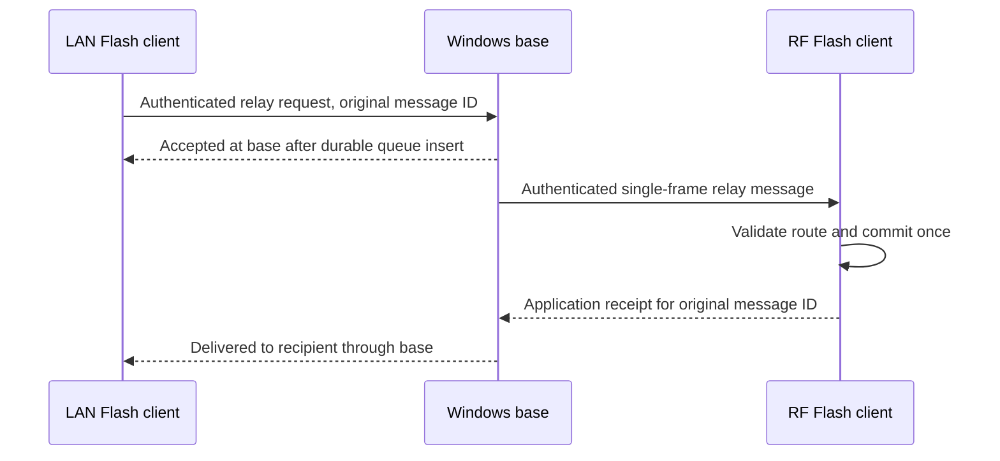

# Radio modes implementation plan

**Research and implementation proposal · 2026-11-15.** Baseline `dev` at `8eca9140`. Mode 3 and Mode 5 are still parked under ADR-210 and FO-28. Hardware evidence below comes from earlier Flash runs.

## Current baseline and order

| Mode | Baseline | Proposed sequence |
|---|---|---|
| 1 · Field Companion | Short direct texts and radio receipts. Android ↔ Windows bidirectional text was confirmed on two radios. The link-down and per-chat Never cases still have device steps owed. | Use as the regression baseline for every phase. |
| 4 · Tactical Radar | `RadioChatEngine.sendLocationReport` can write a `BEACON` frame using the location lane. There are no production callers, and the receive branch has no handler. | Implement first. It can use the current paired radio path and be verified with two stations. |
| 2 · Base Station Relay | The UI lists the mode. The chat bridge selects a path for the originating device. | Implement a single Windows base and explicit direct-text routing. It needs a third Flash client, protocol work, and a trust decision. |
| 3 · Walkie-Talkie Bridge | Local listening and hold-to-talk through vendor RFCOMM audio are built. The owner observed local voice with the KISS link connected. Flash PTT has independent audio devices and floor control. | If unparked, bench-test receive-only into one Flash PTT session first. Add transmit only after the hardware and floor-control checks pass. |
| 5 · All-in-One | A disabled settings row. Plan R defines it as Mode 1 plus Mode 3. | Combine Field Companion with the verified voice bridge and a shared transmit arbiter. Relay and Radar can be added to this mode through a separate product decision. |

[Plan R modes](RADIO-GATEWAY-PLAN.md#5-the-five-modes) · [Radio chat hardware evidence](../testing/TEST-BACKLOG.md#radio-path-01--live-link-policy-and-lan-dial-behaviour-on-the-two-stations-2026-11-05) · [Voice evidence and open checks](../testing/TEST-BACKLOG.md#radvoice-0108-2026-10-23---radio-voice-hear-and-talk-through-the-handheld) · [FO-28](../FUTURE-OPTIMIZATION.md#fo-28---radio-walkie-talkie-voice-bridge-old-radio-modes-3-and-5)

## Research that affects the implementation

Sources checked 2026-11-15. **Verified** means checked against the cited specification, platform documentation or current Flash source. **Reported** means a manufacturer or another project's result. **Measured** means a Flash hardware observation recorded in the repository.

| Finding | Implication |
|---|---|
| **Verified.** KISS hands the host link-layer bytes. AX.25 defines the link layer. Flash sends AX.25 UI frames over it and defines its own identity, encryption and receipts. | Put Mode 2 routing in Flash. A raw KISS bridge or AX.25 digipeater cannot supply the app's LAN trust, routing or delivery contract. [Original KISS paper](https://www.ka9q.net/papers/kiss.html) · [TAPR/ARRL AX.25 v2.2](https://files.tapr.org/tech_docs/AX25/AX25.2.2.pdf) · [Flash wire format](../network/RADIO-WIRE-FORMAT.md) |
| **Verified in Flash.** Profile M has 192 bytes available in one authenticated body. The RF header TTL is outside AEAD authentication. The current text handler queues its link ACK before emitting the message to chat persistence. | Keep new payloads within one frame initially. Use an authenticated one-hop policy and stable identity for relay. Use a separate application receipt after durable commit. [Radio engine receive handler](../../core/radio/src/commonMain/kotlin/com/transfer/flash/core/radio/chat/RadioChatEngine.kt#L532) · [Flash frame and AEAD](../network/RADIO-WIRE-FORMAT.md#5-flash-radio-frame) |
| **Verified in platform docs.** Android can grant only approximate location on API 31+. Microsoft documents a foreground UI-thread consent request for WinRT geolocation, including unpackaged apps. | Start with Android's foreground approximate-location flow and Windows manual coordinates. Windows geolocation and Android background sharing each need a separate host spike. [Android runtime location](https://developer.android.com/develop/sensors-and-location/location/permissions/runtime) · [Microsoft desktop location](https://learn.microsoft.com/en-us/windows/apps/develop/maps-and-location/get-location) |
| **Reported.** Vero lists GPS, KISS and firmware changes. BTECH documents KISS transport and a separate voice product with receive binding and separately granted talk-back. HTCommander publishes its vendor-audio implementation. | Record the exact radio model, firmware, Bluetooth services and active channel behavior. The vendor's Internet voice product is a reference for the permission model. Flash can prototype on its existing LAN PTT sessions and vendor SBC audio. [Vero firmware history](https://www.verotelecom.com/0-7-4-New-Features-Of-The-New-Firmware-a716024.html) · [BTECH KISS](https://baofengtech.com/btech-uv-pro-firmware-update-0-7-11-kiss-mode-now-built-in/) · [BTECH Remote Link](https://baofengtech.com/how-to-set-up-remote-link-btech-app-series-radios/) · [HTCommander audio source](https://github.com/Ylianst/HTCommander/blob/main/src/lib/radio/audio_engine.dart) |
| **Measured in Flash.** The owner reported voice working while KISS stayed connected. A text and its ACK passed during that hardware session. | Simultaneous Bluetooth links are feasible on the tested setup. On-air overlap, radio-busy visibility and transmitter release after loss still need separate measurement. [Radio voice test record](../testing/TEST-BACKLOG.md#radvoice-0108-2026-10-23---radio-voice-hear-and-talk-through-the-handheld) |

## Shared work before enabling a new mode

1. Keep Mode 1 on ADR-227's LAN → Hub → direct radio path, with its active-link, Profile M and per-chat policy checks. Keep radio out of discovery, presence and the file transport planner. List only supported capabilities in the existing gateway UI mapper. A capability requires both host support and the feature's applicable peer or operator setup.
2. Reuse `RadioChatHost`, `RadioChatWiring`, `RadioSession` and the existing counter/replay store. Put RF encoders, filters and scheduling in `:core:radio`, chat session routing and persistence in `:core:messaging` and the existing Room adapters, and lifecycle and permissions in the hosts. The Radio UI should show whether a feature is available, configured, armed and active.
3. Negotiate new feature versions via the authenticated Flash pairing/session path. For off-grid peers, require provisioning while both upgraded clients are reachable through authenticated Flash setup. Re-check revocation and local policy when accepting or transmitting a queued item. An old, unpaired or revocation-stale peer receives no new transmission. Update the exact wire spec and add legacy/golden vectors before enabling a wire extension.
4. Reuse `TxPacingPolicy` for estimates and use a bounded quota for radar and relay. Charge payloads, retries and receipts to that budget. The current scheduler selects emergency → text → ACK → location at task boundaries. Preserve existing traffic behavior and ensure new relay work yields to direct text and its ACKs. Verify that under pressure. A 16-byte position body has 60 bytes at the AX.25 layer and costs about 0.79 seconds with the current pacing defaults. This is an estimate before inter-frame waits and contention. Measure actual airtime, busy behavior and goodput on each firmware before tuning limits.
5. Extend the fake links in `RadioChatEngineTest` and `RadioAudioTest` and the `FakePttAudio` fixtures. Use scripted loss, delayed and duplicate frames, disconnect, restart and a controllable clock for the wire contracts and arbitration. On hardware, record model, firmware, channel setup, path, packet counts and timings. Log only counters, outcomes and short IDs. Keep audio samples, coordinates, message bodies and keys out of diagnostics.

[ADR-227](../decisions.md#adr-227---the-radio-is-an-optional-per-chat-fallback-not-a-transport-radio-data-2026-10-28) · [Radio wiring](../../core/messaging/src/commonMain/kotlin/com/transfer/flash/core/messaging/radio/RadioChatWiring.kt) · [Pacing implementation](../../core/radio/src/commonMain/kotlin/com/transfer/flash/core/radio/driver/TxPacing.kt)

## Mode 4 · Tactical Radar

**First usable slice.** One sender shares an approximate position with a short list of paired, opted-in peers. The receiver sees each person's latest update, age, reported accuracy, and distance and north-up bearing when it knows its own position. Label manual positions and show an unavailable bearing for colocated points. Start with an accessible offline list. Compute great-circle distance and initial bearing in shared Kotlin and check known points against a geodesic reference. Round the display to reflect the accuracy of both fixes. A radar plot can use the same state after distance, bearing and stale states are verified.

- **Wire.** Propose `BEACON` kind 5 with an encrypted, fixed-size versioned body inside Profile M. A candidate 16-byte body has a version byte, a flags byte, two signed 32-bit `latitude × 1000` / `longitude × 1000` values, a 16-bit accuracy in metres, and a 32-bit sample time in Unix seconds. Record exact ranges, byte order, unknown-accuracy semantics and compatibility in a protocol decision. The current wire doc and enum mark kind 5 reserved for signed use, while the sender borrows the generic AEAD encoder and the receiver discards the frame at the app layer. Reconcile this mismatch before enabling the mode, and verify legacy receivers ignore the new data without producing chat or automatic ACKs. Enforce paired encrypted receive and reject unapproved versions, flags, unsigned frames, bad coordinate ranges, segmented input and replay. Use the authenticated peer ID as the sender.
- **Schedule and privacy.** Separate consent from text-chat consent. Ask for Android location only when starting sharing. One foreground sharing session with explicitly selected recipients, off by default and after restart. Start with a proposed 15-minute interval plus jitter, and coalesce to the most recent unsent fix per recipient. Use the lowest priority. Successful send means handoff to the TNC. A later fresh report replaces a dropped or stale one. Stop requests and invalidate unsent reports immediately on disable, permission loss, backgrounding, unpair or gateway stop. Frames already handed to the radio may still be emitted. Keep only the latest accepted peer fix in memory for the first slice, expire it, and show its age from the local receive time. Do not present an old sample or a peer's unsynchronized clock as a current GPS fix.
- **Hosts.** Android API 24+ with the existing AndroidX Core `LocationManagerCompat` one-shot API and cancellation. Request coarse access for the first slice, display reported accuracy and handle unavailable or stale fixes. Approximate OS estimates can be considerably coarser than the roughly 111 m latitude quantization of the proposed payload. Windows starts with a user-entered reference position, labelled manual, and a receive view. If Windows shares a manually entered position, it needs the same per-recipient consent and a visible source label. Radio GPS via the vendor command path is a separate firmware probe. The initial version needs neither a map provider nor Windows location interop.
- **Build order.** First commit the wire decision, version gating and golden vectors. Then add the typed receiver/state, scheduling and math in `:core:radio`. Wire the platform providers and a Radar screen through the gateway controller. Record the component design and accessibility states before implementing the screen.
- **Pass.** A two-station test with a phone and Windows (`BT-R12` in the Radar prompts) shows a new position, estimated accuracy, expected distance/bearing against known points, and stale/expiry rendering. Confirm Windows can receive without requesting a location fix. Deny permission, turn sharing off with reports queued, turn off the gateway, and repeat with an older client. Test dateline, poles, colocated points, unknown local position and clock skew on the host.

[Existing telemetry sketch](RADIO-DATA-INTEGRATION.md#8-telemetry-and-position-phase-2-not-built) · [Beacon engine seam](../../core/radio/src/commonMain/kotlin/com/transfer/flash/core/radio/chat/RadioChatEngine.kt#L381) · [AndroidX `LocationManagerCompat`](https://developer.android.com/reference/androidx/core/location/LocationManagerCompat) · [GeographicLib reference vectors](https://geographiclib.sourceforge.io/geod.html)

## Mode 2 · Base Station Relay

**First usable slice.** A Windows base with one radio forwards short direct messages between one authenticated Wi-Fi client and one paired RF client, in both directions. Select the base and recipient route explicitly. A base operator arms the session and approves the source–destination tuples and direction. The interface exposes the base, queued work, awaiting recipient and stop controls. Start with one base per route and no base chaining.

- **Trust model.** Propose a trusted application base that can read the text. LAN uses the existing authenticated Flash session. The RF leg uses the base's existing pairwise session key with the field peer. Show that the origin attribution comes from the selected base and validate the base against the configured route. Keep member keys on their devices. If the base must be unable to read or forge the original message, prototype an endpoint-authenticated encrypted envelope carried through the base. That option requires original endpoints to share trust material, a key/identity lifecycle, compatible receipt verification and a measured frame budget. Resolve this choice before freezing the wire design.
- **Protocol and persistence.** Add typed relay request, acceptance, failure and application receipt on authenticated Flash sessions, plus a distinct typed RF relay message and durable application receipt. Never stuff the relay envelope into chat `TEXT`. Fit the UUID, authenticated route/identity representation, version and UTF-8 text into the 192-byte protected-body budget. Prototype compact route identifiers from provisioning and measure the remaining text bytes. Fail visibly above that limit. Keep original `TextMessage.localId` end to end. Dedup by authenticated origin plus message UUID with target and body digest bound to the first accepted request. Use indexed unique keys, bounded storage and expiry across restart. A retry can resend an existing persisted receipt. The receiver must commit an inbound message once before issuing that receipt. The LAN and RF protocols must both echo the same stable identity with addressing bound to the configured route.
- **Routing and scheduling.** Reject wrong directions, base-to-base requests, unknown routes, overlapping source/target and expired work before RF enqueue. A valid duplicate returns the previous state without queuing another transmission. Enforce single-hop forwarding in the authenticated app policy. The editable RF-header TTL cannot grant a route. Use bounded per-source and global admission budgets, and a low-priority relay queue subject to the shared airtime cap. Start with bounded per-message expiry and one explicitly selected base. Keep pending work recoverable after a crash and re-arm before any resumed RF send. Check queue/refusal state and revocation again before keying. Define the stop and expiry actions explicitly. Apply the same delivery contract in the reverse RF → base → LAN direction.
- **Build order.** Write the protocol/identity decision and acceptance states first. Implement a pure relay policy with persistence and crash cuts. Wire explicit submission and authenticated LAN routing, then the typed RF messages and post-commit receipts. Keep default direct chat selection independent of this mode. Add the base management UI only once the state reflects what the engine can guarantee.
- **Pass.** Three Flash clients and two radios, including a LAN-only phone with no radio and a field peer with no LAN or Hub path. A short text and a reply each appear once under the correct identity. Show base acceptance separately from final delivery. In host tests, drop a receipt, reconnect, replay the same UUID, and stop the base or recipient at each durability boundary. Check unauthorized clients, a second base, tampered TTL, long messages, queue expiry, link down, revoked routes and protection of the direct chat/ACK budget. On devices, repeat the live round trip after a base restart and explicit re-arm. Align the run with Plan R's `BT-R07`.

[LAN message identity and receipt](../../core/messaging/src/commonMain/kotlin/com/transfer/flash/core/messaging/protocol/MessageWireFrame.kt#L9) · [R5 and BT-R07](RADIO-GATEWAY-PLAN.md#10-phases) · [Current radio ACK and text receive](../../core/radio/src/commonMain/kotlin/com/transfer/flash/core/radio/chat/RadioChatEngine.kt#L532)

## Mode 3 · Walkie-Talkie Bridge

**Research recommendation if reopened.** Use the current vendor RFCOMM audio path, `RadioAudioSession`, and the `PttAudioPlatform` seam for Flash's PCM16 LAN PTT. Compose them in the host with PCM input and output adapters and a single floor coordinator. Keep `:core:ptt` independent of radio. Reuse SBC framing and the existing resampler. Keep the local radio card on its existing mic/speaker path. This proposal supersedes ADR-211's SCO assumption if accepted. The existing Flash PTT floor engine already decides when capture/playout starts and stops, so the bridge can use that contract without changing ordinary PTT audio transport.

1. **Bench feasibility.** Play PCM fixtures through a fake vendor link and fake Flash PTT devices. Route decoded radio audio through the established PTT session under the authenticated gateway identity with an RF source label. Choose bridge input/output adapters for that session. Verify radio packets/echo, RF audio output, and mic input cannot feed back into the wrong path. Use bounded buffers and discard stale samples. Check format boundaries and the resampler across 32 kHz radio PCM and the negotiated Flash PCM rate.
2. **Receive-only on hardware.** Deliberately bind one radio channel to one eligible Flash session. Use the current vendor RX start/end events as a floor request. If the floor is unavailable, drop the burst cleanly rather than replaying it later. Flash users see that they are receiving analog RF audio. On stop, leave, disconnect or session switch, release the synthetic floor and clear queued audio. Verify Android and Windows separately with the radio card disabled for this path.
3. **Controlled transmit.** Add explicit authorization per PTT participant and a separately armed return path. Begin with a named, deliberate press and a capped talk burst. Transmit only while that session and floor are current and the radio is available. Enforce a single direction at a time. Local stop, floor loss, missing audio, call interference, Bluetooth/session loss and app stop invalidate the lease and discard buffered audio. Send the vendor END frame when the link remains writable. With the link severed, qualify the radio's own unkey timeout by watching a second receiver. If RF-busy or unkey behavior cannot be confirmed for the radio and firmware in use, publish receive-only support for that combination. Analog RF exposure must be visible before talk-back is armed.
4. **Hardware pass.** Use a Flash PTT client, a gateway and a conventional second handheld/radio. Verify receive-only creates zero RF transmissions. Verify clear audio both directions, one floor at a time, busy refusal, grant revocation, app killed mid-press, cable/Bluetooth loss, and no echo loop. Record press-to-first-intelligible-audio and release-to-carrier-drop. Use the existing one-second release target when the link is writable. Set the disconnected release bound from the hardware spike before enabling talk-back. Preserve the existing `RADVOICE-04/12` coexistence and Windows local-voice checks.

[Flash PCM device seam](../../core/ptt/src/commonMain/kotlin/com/transfer/flash/core/ptt/PttAudioDevices.kt) · [Radio vendor audio transport](../network/RADIO-AUDIO.md) · [Windows RFCOMM](https://learn.microsoft.com/en-us/windows/win32/bluetooth/bluetooth-and-socket) · [Android input sharing](https://developer.android.com/media/platform/sharing-audio-input)

## Mode 5 · All-in-One

Use the Mode 1 data and Mode 3 voice controllers on one radio. One host-level arbiter owns RF transmit permission across both links. An admitted data frame gets its measured completion or a conservative bounded guard before voice can key. During RF RX or an active voice lease, defer data within its expiry, including ACKs. Revalidate the session before each new voice burst and enforce the data deadline and scheduler ordering after release. Avoid future TNC backlog while voice is armed. Host pacing and successful Bluetooth writes provide estimates of on-air completion. Confirm what the radio actually exposes before relying on the arbiter as proof of channel state.

- Expose data and voice link states separately and show the current direction, why a path is waiting, and the local stop action. Reconnect returns to an unarmed voice state. Keep the Mode 1 text path available if the voice endpoint cannot open.
- Test voice starting during a data frame or ACK, text arriving during voice, receive busy, expiry, sustained pressure, duplicate delivery, reconnect, wrong channel/session binding and stop during simultaneous demand. On hardware confirm both Bluetooth links, observe RF on a separate receiver, measure ACK delay and voice unkey, and verify there is no concurrent keying or burst replay. Make Mode 5 selectable only on the host/radio combinations that pass the combined matrix.

[Current KISS pacing assumptions](../../core/radio/src/commonMain/kotlin/com/transfer/flash/core/radio/driver/TxPacing.kt#L3) · [Vendor coexistence evidence](../network/RADIO-AUDIO.md#unknowns-that-only-hardware-answers)

## Decisions before implementation freezes a contract

| Decision | Proposed default |
|---|---|
| Radar visibility and range | Approximate foreground sharing for explicitly selected peers, 15 minutes with jitter and a measured budget. Windows receives and can use a manual reference. |
| Relay confidentiality | A single explicitly trusted Windows base may read the text. Require end-to-end encrypted and authenticated relay if the deployment cannot trust the base with contents or origin. |
| Voice scope | Reopen Mode 3 as a receive-only feasibility stage first, with one session. Expose remote talk-back separately after the hardware checks. Build Mode 5 only after the Mode 3 decision and combined test. |
| Release scope | Start Android and Windows with the exact radios and firmware exercised in the runs. Record the authorized radio service used for any live RF test. Shared code can remain platform-neutral while host support is verified. |

Start implementation with the Mode 4 wire and compatibility proposal plus host-only round-trip vectors. Keep the remaining mode cards unavailable until their applicable gates pass. Connect each implemented phase to the existing device backlog, with exact test environment and results.
